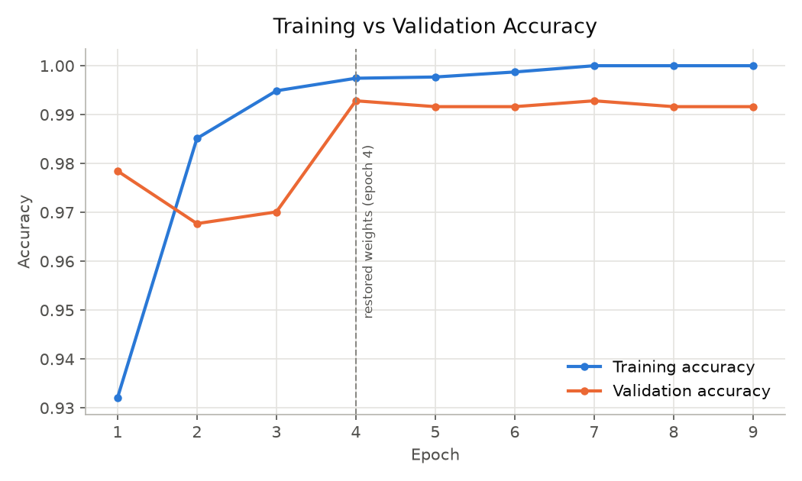
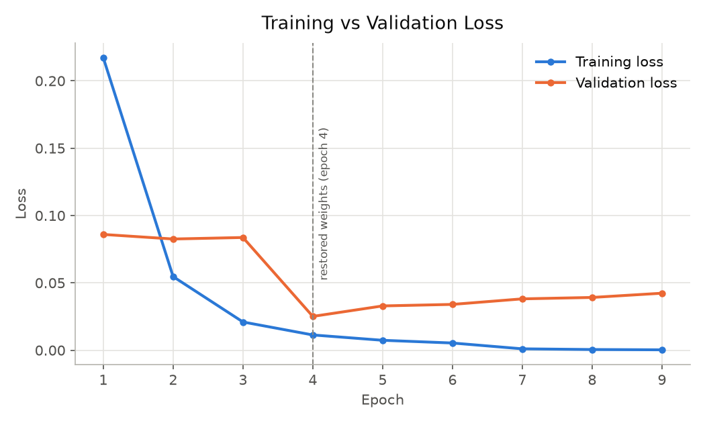
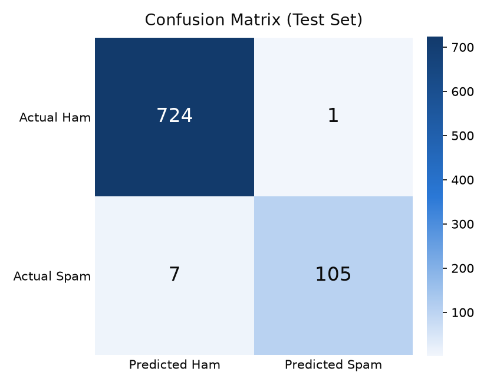

# RNN SMS Spam Detection

Binary classification of SMS messages (**spam** vs **ham**) with a Recurrent Neural Network in
TensorFlow/Keras, trained on the real **UCI SMS Spam Collection** (5,574 messages).

```
Embedding (5,000 × 64) → GRU (64) → Dense (32, ReLU) → Dropout (0.3) → Dense (1, Sigmoid)
```

## Results (final model, held-out test set of 837 messages)

| Accuracy | Precision (spam) | Recall (spam) | F1 (spam) | Confusion matrix [[TN, FP], [FN, TP]] |
|---|---|---|---|---|
| **99.04 %** | **0.9906** | **0.9375** | **0.9633** | [[724, 1], [7, 105]] |

The model was selected by **validation** F1 out of six attempts (SimpleRNN, LSTM, GRU, with
different regularisation settings). The full table of attempts and every assumption are in
[NOTES.md](NOTES.md).

| Accuracy | Loss | Confusion matrix |
|---|---|---|
|  |  |  |

## Project layout

```
RNN_SMS_Spam_Detection/
├── data/            SMSSpamCollection.tsv (UCI, unchanged) + original readme.txt
├── src/
│   ├── config.py           paths and constants
│   ├── data_prep.py        cleaning, tokenizer, padding, stratified 70/15/15 split
│   ├── model.py            Embedding → SimpleRNN/LSTM/GRU → Dense → Sigmoid
│   ├── metrics.py          accuracy, precision, recall, F1, confusion matrix
│   ├── train.py            trains one experiment (A1 … A6) and logs its metrics
│   ├── evaluate.py         picks the best run by validation F1, tests it, draws graphs
│   ├── predict.py          classify custom SMS messages
│   └── check_predictions.py  sanity check of predict.py on 8 new messages
├── models/          best_model.keras, tokenizer.json, best_history.json, best_config.json,
│                    experiments/ (every attempt's model + history)
├── outputs/         accuracy_graph.png, loss_graph.png, confusion_matrix.png, *.json results
├── report/          RNN_SMS_Spam_Detection_Report.docx (+ build_report.py)
├── ppt/             RNN_SMS_Spam_Detection.pptx (+ build_ppt.py)
├── Dockerfile, requirements.txt, NOTES.md
```

## How to run

### Option A – plain Python (Linux / macOS / Windows without Smart App Control, or Colab)

```bash
pip install -r requirements.txt
python src/data_prep.py                       # dataset statistics
python src/train.py --exp A6_gru_softer_weights   # or A1_baseline … A5_gru
python src/evaluate.py                        # select best by validation, test, save graphs
python src/predict.py "WINNER!! Claim your free prize now, call 09061701461"
python src/predict.py                         # interactive mode
```

### Option B – Docker (what was used to produce the results)

```bash
docker build -t rnn-sms-spam .
docker run --rm -v "$PWD:/project" rnn-sms-spam python src/train.py --exp A6_gru_softer_weights
docker run --rm -v "$PWD:/project" rnn-sms-spam python src/evaluate.py
docker run --rm -v "$PWD:/project" rnn-sms-spam python src/predict.py "Free entry! Text WIN to 85233"
```

Example output of `predict.py`:

```
SPAM  (spam probability 1.0000)  <- Congratulations! You have won a GBP 1000 cash prize. Call 09061234567 now to claim, T&C apply
HAM   (spam probability 0.0000)  <- Hey, are we still meeting for lunch tomorrow at 1?
```

The report and slides are generated from the result files with
`python report/build_report.py` and `python ppt/build_ppt.py` (these need `python-docx`,
`python-pptx`, and `../Sample report.docx` for the report template).

## Dataset

Almeida, T. A., Gómez Hidalgo, J. M., Yamakami, A. *Contributions to the Study of SMS Spam
Filtering: New Collection and Results.* ACM DocEng 2011. UCI Machine Learning Repository,
dataset 228. The original licence and readme are in `data/readme.txt`.
